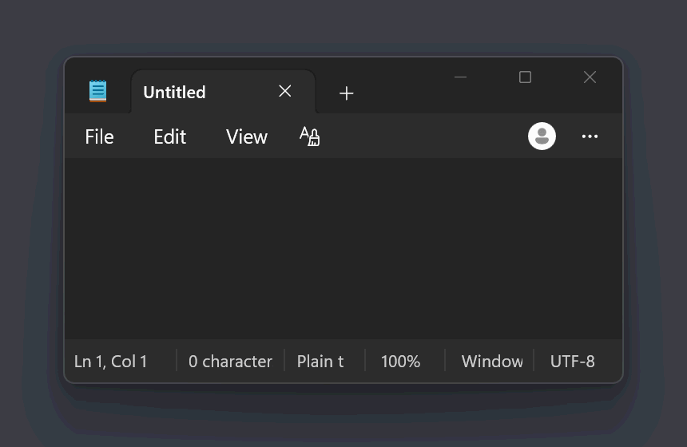

# Window Focus Highlighter

A tiny Windows tray app that briefly highlights whichever window just received focus, then fades out.
Never lose track of where your keyboard focus went again.

About 50 KB, plain C with the Win32 API, no runtime or installer, and no polling.



## Features

- Three styles: **Border**, **Tint**, or **Border + tint**, with adjustable color, opacity, thickness and soft glow edge.
- Follows Windows' corner rounding (rounded on Windows 11, square on Windows 10 and for maximized windows).
- The highlight follows the window if you move or resize it while it is showing.
- Ignores the taskbar, Alt-Tab, Start menu, desktop, minimized and hidden windows, plus any programs you add to an ignore list.
- Global hotkey to pause and resume (default Ctrl+Alt+H), optional start with Windows.
- Settings apply live, with a preview, and follow the system light/dark theme.
- Correct on high-DPI and multi-monitor setups.

See [FEATURES.md](FEATURES.md) for the full list.

## Usage

Run `WindowFocusHighlighter.exe`. It lives in the system tray. Double-click the tray icon, or right-click it and
choose **Settings**, to configure it. Launching the exe a second time also opens the settings window.

Settings are stored in `%APPDATA%\WindowFocusHighlighter\settings.ini`.

## Building

Requires Windows 10 or later and [MinGW-w64](https://www.mingw-w64.org/) (`gcc` and `windres`) on your PATH.

```bat
build.bat
```

This produces `WindowFocusHighlighter.exe`. If it is already running, exit it from the tray first, since the running exe locks the file.

## License

[MIT](LICENSE)
